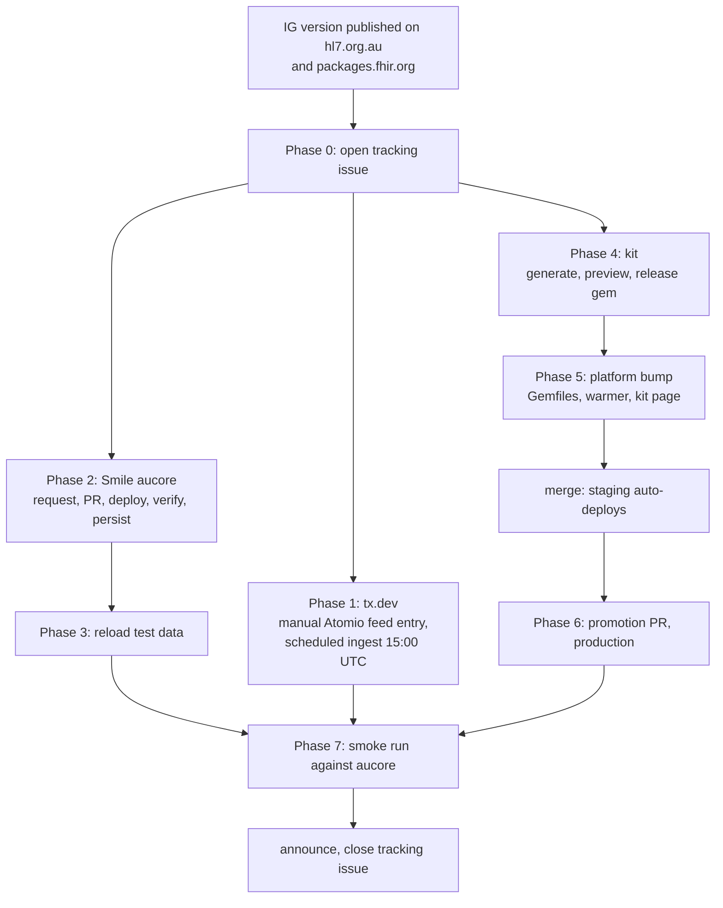

# Runbook: releasing a new IG version to Sparked

How a newly published HL7 AU Implementation Guide version reaches every Sparked target:
the Sparked Dev FHIR Server, the tx.dev terminology server, the Inferno test kits and
platform (staging and production), and the test data on the server.

| | |
|---|---|
| **Track each release in** | one [IG Release Tracking issue](../../.github/ISSUE_TEMPLATE/07-ig-release-tracking.md) per IG version ([open one](https://github.com/aehrc/sparked-fhir-server-configuration/issues/new?template=07-ig-release-tracking.md)) |
| **Last verified** | 2026-11-26, against `main` of this repo, the default branches of `hl7au/au-fhir-inferno`, `au-fhir-core-inferno` and `au-ps-inferno`, `main` of `aehrc/sparked-argo` (private), the `sparkey` cluster (read-only) and the live services named below. First written and checked on 2026-09-25 to 29; every command marked "verified" was re-run on 2026-11-26 unless it gives another date. Anything not verified is marked **(unverified)** inline. |
| **Typical elapsed time** | 10 to 12 days from publication to production Inferno for the last two AU Core cycles; the Smile server alone took 1 and 7 days in those cycles, and 18 days for AU Core 2.0.0 (see [History](#history)). |

## Contents

- [1. Purpose and scope](#1-purpose-and-scope)
- [2. Roles](#2-roles)
- [3. The flow at a glance](#3-the-flow-at-a-glance)
- [4. Ordering constraints](#4-ordering-constraints)
- [5. Before you start](#5-before-you-start)
- [6. Procedure](#6-procedure)
  - [Phase 0: Detect and open the tracking issue](#phase-0-detect-and-open-the-tracking-issue)
  - [Phase 1: tx.dev terminology server](#phase-1-txdev-terminology-server)
  - [Phase 2: Sparked Dev FHIR Server (Smile CDR, aucore)](#phase-2-sparked-dev-fhir-server-smile-cdr-aucore)
  - [Phase 3: Test data](#phase-3-test-data)
  - [Phase 4: Test kit (gem)](#phase-4-test-kit-gem)
  - [Phase 5: Inferno platform, staging](#phase-5-inferno-platform-staging)
  - [Phase 6: Inferno platform, production](#phase-6-inferno-platform-production)
  - [Phase 7: Smoke run, announce, close](#phase-7-smoke-run-announce-close)
- [7. Done means](#7-done-means)
- [8. Gotchas reference](#8-gotchas-reference)
- [9. Rollback](#9-rollback)
- [10. Automation backlog](#10-automation-backlog)
- [History](#history)

---

## 1. Purpose and scope

A new IG version (draft, ballot, preview or trial-use) is published by HL7 AU at
`hl7.org.au`. Sparked has to make that version usable in four places, owned across seven
repositories in two GitHub organisations. Nothing links those steps today except this
runbook and the tracking issue, so the runbook states the order, the exact action, the
check that proves each step worked, and the ways each step has failed before.

### Which IG reaches which target

| IG (package id) | Smile `aucore` | tx.dev | Inferno kit | Test data |
|---|---|---|---|---|
| AU Base (`hl7.fhir.au.base`) | yes | yes, manual feed entry | no kit of its own (AU Core depends on it) | only if AU Core test data changes with it |
| AU Core (`hl7.fhir.au.core`) | yes | yes, manual feed entry | `hl7au/au-fhir-core-inferno` | yes |
| AU Patient Summary (`hl7.fhir.au.ps`) | yes | yes, manual feed entry | `hl7au/au-ps-inferno` | if the AU PS examples change |
| International Patient Summary (`hl7.fhir.uv.ips`) | yes | no | no | no |
| AU eRequesting (`hl7.fhir.au.ereq`) | **no** (the `ereq` node was decommissioned on 2026-08-02, #85 and #87) | yes, manual feed entry | no | no |

For Smile the authoritative list is `package_registry.startup_installation_specs` for
`aucore` in
[`module-config/simplified-multinode.yaml`](../../module-config/simplified-multinode.yaml);
if this table disagrees with that file, the file wins, so fix the table. For tx.dev the
authoritative list is the set of entries in the Atomio feed `hl7au-dev`, which is only
readable after signing in (step 1.1). The tx.dev column is the set of IGs the
decommissioned feeder used to push, so treat it as the default rather than a rule.
[`terminology-servers/tx-dev-helm-values.yaml`](../../terminology-servers/tx-dev-helm-values.yaml)
is no longer deployed by anything and does not describe tx.dev.

### Targets

| Target | What it is | Changed through |
|---|---|---|
| Sparked Dev FHIR Server | Smile CDR node `aucore`, `https://smile.sparked-fhir.com/aucore/fhir/DEFAULT` | this repo: IG Release request, `Re/load IG Packages` workflow; merging the PR also deploys the seed config through the Argo CD Application `smilecdr`, which syncs automatically ([step 2.4](#step-2-4)) |
| tx.dev | Ontoserver at `https://tx.dev.hl7.org.au/fhir`, which syndicates from the Atomio feed `hl7au-dev` on `synd.ontoserver.csiro.au` | an entry added by hand to `hl7au-dev` in the Atomio dashboard; the feed list and schedule are in `aehrc/sparked-argo` `apps/ontoserver/values.yaml` (private), and the event freeze pause switch in `apps/ontoserver/values-event-freeze.yaml` (`aehrc/sparked-argo` #385) |
| Inferno test kits | Ruby gems `au_core_test_kit` and `au_ps_inferno` on RubyGems | `hl7au/au-fhir-core-inferno`, `hl7au/au-ps-inferno` |
| Inferno platform | staging `https://development.inferno.sparked-fhir.com`, production `https://inferno.hl7.org.au` | `hl7au/au-fhir-inferno`, deployed by ArgoCD from `aehrc/sparked-argo` (private) |
| Test data | the AU FHIR test data set loaded onto `aucore` | `hl7au/au-fhir-test-data`, with AU Core read from the Sparked branch `sparked-aucore-loadable` of `aehrc/au-fhir-test-data`; loaded and tracked by the test data loader at `https://loader.sparked-fhir.com` (Phase 3) |

Not a target: the ci-build environment `https://ci-build.inferno.sparked-fhir.com`
(`hl7au/au-fhir-inferno` #221, #222; Argo CD Application `inferno-ci-build`). It runs
each kit's CI-build suite (`au_core_ci_build`, `au_ps_ci_build`), regenerated nightly from
the IG's CI build on `build.fhir.org` on each kit's `ci-build` branch, and is launched
from a radio on staging's kit pages. It follows the IG's CI build by itself, so a
published release changes nothing there, but it is the place to look at a ballot's
content before it is published.

### Out of scope: hand-offs only

- **`fhir.hl7.org.au`**, the HL7 AU reference FHIR server, and **tx.hl7**
  (`synd.tx.hl7.org.au`), the HL7 AU reference terminology server. Both are HL7-hosted.
  Any change needs the `needs:hl7-approval` label and Brett Esler's sign-off
  ([Environment scrutiny](../SERVICE-CATALOGUE.md#environment-scrutiny)). The tx-hl7
  feeder is not deployed (removed from ArgoCD in `aehrc/sparked-argo` #72), so tx.hl7
  content is not changed from here at all. The runbook's only step is to tell the owner
  (Phase 7).
- **Authoring or publishing the IG.** That is HL7 AU's process; this runbook starts after
  publication.

## 2. Roles

One person can hold several roles. The "today" column is who has done the step in the last
three cycles, so a new engineer knows who to ask.

| Role | Does | Today |
|---|---|---|
| **Release lead** | Opens and drives the tracking issue, owns Phases 0, 1, 2, 5 to 7 | @KyleOps |
| **Requester** | Files the Smile IG Release request; says whether test data must change | HL7 AU product team (for example @dt-r) |
| **Repo admin** (this repo) | Reviews the request, arms or bypasses automation, merges (the merge is also the Smile deploy: Argo CD syncs automatically, step 2.4), runs Terraform for infrastructure changes (needs the `AdministratorAccess` SSO permission set) | @KyleOps |
| **Kit maintainer** | Generates the suite and releases the gem (Phase 4) | @projkov |
| **Platform reviewer** | Reviews `au-fhir-inferno` PRs. The `master` ruleset needs 1 approving review, code-owner review and a green `quality-control`. A kit bump touches `Gemfile*` and `infra/`, which `CODEOWNERS` gives to the release owners, so one of them must approve it. | @KyleOps or @brettesler-ext for a kit bump |
| **HL7 AU approver** | Signs off anything touching `fhir.hl7.org.au` or tx.hl7 | Brett Esler |

## 3. The flow at a glance



Phases 1, 2 and 4 start in parallel once the tracking issue exists. The joins are the
[ordering constraints](#4-ordering-constraints). tx.dev does not gate starting Phase 2;
it gates judging validation results (constraint 2), so it joins at the smoke run. No
step that changes a live service may land inside an event freeze (constraint 9).

## 4. Ordering constraints

Each of these has been broken at least once, or would silently break a later step.

1. **The package must be on `packages.fhir.org` before anything else starts.** Smile
   resolves packages from the registry, and a generated suite names its IG as
   `hl7.fhir.au.core#<version>`, which the validator downloads from the registry. A suite
   generated before registry publication was pointed at a local file instead, and every
   deployed validator failed ("Unable to find/resolve/read -ig", `hl7au/au-fhir-inferno`
   #130).
2. **tx.dev should carry the release before anyone judges validation results.** Both the
   Smile node (`remote_term_svc.base_url`) and the Inferno validator
   (`validator.terminologyServer`) validate terminology against
   `https://tx.dev.hl7.org.au/fhir`. Nothing adds a release to tx.dev automatically, and
   tx.dev is scheduled to ingest once a day (15:00 UTC), so do step 1.1 on day one.
3. **On Smile, dependencies install before the IG, and coupled IGs ship in one PR.** AU
   Core 3.0.0-ballot1 declares, among others, AU Base 7.0.0-ballot1, `hl7.terminology.r4`
   7.3.0 and `smart-app-launch` 2.2.0; those went out together in #91 and #92. Separate IG PRs also
   conflict on the same three files.
4. **The kit gem must be on RubyGems before the platform's `Gemfile` changes.** Staging and
   production build from `Gemfile`; only preview environments build from `Gemfile.dev`.
5. **In the kit repo, the version bump merges before the tag.** `publish-gem.yaml` refuses a
   release whose tag differs from `version.rb`.
6. **The platform's `inferno_suite_generator` ref must suit every released kit it loads.**
   The generator is a runtime dependency of both kits and is pinned once, in
   `Gemfile.common`.
7. **Smile deployed, test data reloaded and tx.dev caught up before the smoke run** in
   Phase 7; otherwise failures are about the environment, not the kit.
8. **Staging verified before the production promotion PR is merged.** Staging and
   production run the same image, so staging is the last place to catch a bad bump.
9. **Nothing that changes a live service lands inside an event freeze.** For a
   connectathon or testing event, the event manifest `events/<yyyy-mm>-<place>.yaml` in
   this repo sets `freeze.start` and `freeze.end` (for December 2026,
   `events/2026-12-melbourne.yaml`: Fri 4 Dec 17:00 to Fri 11 Dec 17:00 AEDT). Inside that
   window: no IG load, `Re/load IG Packages` run, Smile deploy (a merge to
   `module-config/` or `deploy/`, step 2.4) or test data reload on `aucore`; no merge to `hl7au/au-fhir-inferno` `master` (production's chart
   follows `master`, and Argo CD sync windows on `inferno-prod` and `inferno-ci-build` only
   hold a merge until unfreeze, when it lands unwatched); no new entry in the `hl7au-dev`
   feed (tx.dev's scheduled preload is paused, but a replica that restarts during the
   freeze still runs its startup preload, which would load the entry on that replica
   alone). Kit work that changes no live service (steps 4.1 to 4.4, a platform PR left
   unmerged) can go on. Work backwards from the freeze: the event runbook in
   `aehrc/sparked-argo` (`docs/runbooks/event-runbook.md`, sections 1 to 3) wants the
   Inferno release participants will use on production two weeks before the event
   (section 1, step 3), and no Renovate or Argo CD upgrade merged in `aehrc/sparked-argo`
   after T-1 week (section 1, step 4: cluster platform upgrades, not the Inferno
   platform). A release that cannot finish by then starts
   after unfreeze.

## 5. Before you start

- Write access to this repo (to arm automation, merge and run workflows).
- Whether an event freeze is coming (constraint 9): `ls events/` in this repo and read
  each upcoming manifest's `freeze` block.
- For Phase 2 persistence: nothing beyond merge rights, because the merge is the deploy
  (the Argo CD Application `smilecdr` syncs automatically). A manual sync, needed only
  for an emergency fix in a freeze or to retry a failed sync, needs sync rights on the
  Application (the `argocd-admin` or `argocd-developer` group) in the Argo CD UI, or
  kubectl; the `argocd` CLI's SSO login fails today. The procedure is
  [sparkey-deploy-runbook.md](../sparkey-deploy-runbook.md), section A. Terraform
  (`AdministratorAccess`, inputs from `scripts/fetch-smile-tfvars.sh`, [smile-deploy-inputs.md](../smile-deploy-inputs.md))
  is needed only for an infrastructure change, such as a new generator jar.
- Where the workflows run: `Re/load IG Packages` and the issue automation jobs run on
  GitHub-hosted runners (#124) and reach Smile through its public hostname. The exception
  is SMART client registration (`register-smart-client` in `issue-labeled.yml`, and
  `register-smart-clients.yml`), which runs on the `arc-runner-smile-admin` set inside
  `sparkey` because it calls the admin JSON API in-cluster (#122); no IG release step
  needs that API. Test data is loaded by the test data loader, a service of its own
  (Phase 3), not by a workflow. The admin JSON API and admin console answer only to an IP
  allowlist at the gateway (`aehrc/sparked-argo` #388); the FHIR and package endpoints
  are not on it.
- Write access to `hl7au/au-fhir-inferno` (Phases 5 and 6). Kit repos only if you are the
  kit maintainer.
- `curl` and `jq`. Every check below is a plain HTTPS GET unless it says otherwise.

Set these once per release; every command below uses them:

```bash
PKG=hl7.fhir.au.core          # package id
VER=3.0.0-ballot1             # new version
FHIR=https://smile.sparked-fhir.com/aucore/fhir/DEFAULT
TX=https://tx.dev.hl7.org.au/fhir
PROFILE=http://hl7.org.au/fhir/core/StructureDefinition/au-core-patient   # any profile the IG defines
```

---

## 6. Procedure

Every step lists **Who**, **Where**, **Do**, **Verify** and **What goes wrong**. Tick the
matching box in the tracking issue as you go and paste the evidence (a link or the command
output) into the issue.

### Phase 0: Detect and open the tracking issue

<a id="step-0-1"></a>
#### 0.1 Notice the publication

- **Who:** release lead.
- **Where:** the HL7 AU package feed `https://hl7.org.au/fhir/package-feed.xml`, or the
  IG's `package-list.json` (AU Base `https://hl7.org.au/fhir/package-list.json`; the
  others add `core/`, `ps/` or `ereq/`; IPS is
  `https://hl7.org/fhir/uv/ips/package-list.json`).
- **Do:** check the feed. Nothing watches it for any Sparked target: the tx-dev
  fhir-ig-feeder that pushed new versions to tx.dev was decommissioned on 2026-09-29
  (`aehrc/sparked-argo` #285).

  ```bash
  curl -s https://hl7.org.au/fhir/package-feed.xml | grep -o '<title>[^<]*</title>'
  ```

- **Verify:** the package is on the registry. Use GET: `packages.fhir.org` answers 404 to
  HEAD (verified).

  ```bash
  curl -s -o /dev/null -w '%{http_code}\n' "https://packages.fhir.org/$PKG/$VER"   # expect 200
  ```

- **What goes wrong:** starting before the registry has the package (constraint 1).

<a id="step-0-2"></a>
#### 0.2 Open the tracking issue and decide the targets

- **Who:** release lead.
- **Where:** [IG Release Tracking](https://github.com/aehrc/sparked-fhir-server-configuration/issues/new?template=07-ig-release-tracking.md).
- **Do:** one issue per IG version. Fill in the fields, tick "applies" for each target using
  the [scope table](#which-ig-reaches-which-target), and record the dependency list:

  ```bash
  curl -sL "https://packages.fhir.org/$PKG/$VER" | tar xzO package/package.json | jq '.dependencies'
  ```

  If a dependency is itself a new version (AU Core 3.0.0-ballot1 declared AU Base
  7.0.0-ballot1), open or link that IG's tracking issue and plan one Smile PR for both.
- **Verify:** the issue exists with the published date filled in (from `package-list.json`
  `date`), so elapsed time can be measured at close.
- **What goes wrong:** a new dependency version missed here surfaces in Phase 2 as a
  profile that loads but validates against the wrong base.

### Phase 1: tx.dev terminology server

<a id="step-1-1"></a>
#### 1.1 Add the release to the `hl7au-dev` Atomio feed

tx.dev has no automated feed any more. The tx-dev fhir-ig-feeder, which watched the HL7 AU
package feed and pushed AU Base, AU Core and AU eRequesting into `hl7au-dev`, was
decommissioned on 2026-09-29 (`aehrc/sparked-argo` #285; its Application no longer exists,
verified). Every IG version that should reach tx.dev now needs an entry added by hand, which
is the process that was used before the feeder went live on 2026-07-05.

- **Who:** release lead, or anyone with write access to the `hl7au-dev` feed. Who holds
  that access today is not recorded here **(unverified)**. The HL7 Confluence page below
  lists only read-only dashboard access as its prerequisite, and adding an entry needs
  more than that.
- **Credential at risk:** the only known write credential for `hl7au-dev` is the retired
  feeder's Keycloak client (scopes `onto/synd.read` and `onto/synd.write` in
  [`terminology-servers/tx-dev-helm-values.yaml`](../../terminology-servers/tx-dev-helm-values.yaml)),
  whose `clientId` and `clientSecret` are in the Secrets Manager secret `fhir-feeder-tx-dev`
  (ap-southeast-2). That secret still exists (verified 2026-11-26, metadata only; last
  read 2026-09-28). `aehrc/sparked-argo`
  #285 lists deleting it, and revoking the client, as manual follow-ups. Do not delete the
  secret or revoke the client until a human write path to `hl7au-dev` is confirmed:
  someone has added an entry with their own login. Until then, losing it may leave nobody
  able to add a release to tx.dev.
- **Where:** the Atomio dashboard (`https://ontoserver.csiro.au/atomio/feeds`, sign in
  with AAF against the syndication server `https://synd.ontoserver.csiro.au`), feed
  `hl7au-dev`. tx.dev's Ontoserver reads that feed, alongside `hl7au-fragments` and the
  NCTS SNOMED CT feed (`atom.preload.feedLocation` and `atom.syndication.feedLocation` in
  `aehrc/sparked-argo` `apps/ontoserver/values.yaml` on `main`, and the same values on the
  running StatefulSet, verified). The step-by-step
  procedure, with screenshots, is the HL7 Confluence page
  [Process: HL7 AU Dev Terminology Server](https://confluence.hl7.org/pages/viewpage.action?pageId=265093732)
  (space HAFWG). Its link to the Ontoserver configuration in `aehrc/sparked-infrastructure`
  is stale; the configuration now lives in `aehrc/sparked-argo` (page read 2026-09-29, not
  re-read).
- **When:** not inside an event freeze (constraint 9). An entry added during a freeze is
  not picked up by a scheduled run, because the freeze pauses it, but a replica that
  restarts reads it in its startup preload, so the two replicas would serve different
  content for the rest of the event.
- **Do:**
  1. Download the package and read the values the entry needs (verified):

     ```bash
     curl -sL -o "$PKG-$VER.tgz" "https://packages.fhir.org/$PKG/$VER"
     tar xzO -f "$PKG-$VER.tgz" package/package.json | jq -c '{name, version, title, fhirVersions}'
     ```

     The same file is published with the IG, for example
     `https://hl7.org.au/fhir/core/3.0.0-ballot1/package.tgz` (verified), which is the link
     the Confluence page tells you to copy.
  2. In Atomio, find the `hl7au-dev` feed, open its details and search for the package to
     confirm this version is not already an entry.
  3. Choose **Add entry** and fill it in as the Confluence page describes: Title
     `<IG type> IG <version>`, Content Item derived from the IG release URL, Content
     Version the IG version, FHIR Version from `fhirVersions`, and the `.tgz` as the file.
     The page does not give the exact Content Item form, so copy it from an earlier entry
     for the same IG. Then **Create Entry**.
  4. Paste the entry's title and the time you added it into the tracking issue, so step 1.2
     knows which 15:00 UTC run to wait for.

  None of this has been exercised since the feeder was decommissioned **(unverified)**.
- **Verify:** the entry is listed in the feed details in Atomio. The feed answers `401` to
  an anonymous GET (verified), so there is no `curl` check here; step 1.2 is the
  end-to-end check.
- **What goes wrong:** skipping this step. Until #285 AU Base, AU Core and AU eRequesting
  reached tx.dev without anyone acting, and only AU PS (pinned in the feeder config) needed
  a hand edit. Now every IG is missed unless someone adds it.

<a id="step-1-2"></a>
#### 1.2 Confirm tx.dev has ingested it

- **Who:** release lead.
- **Where:** `https://tx.dev.hl7.org.au/fhir`. Each of the two Ontoserver replicas preloads
  its feeds once a day at **15:00 UTC** (`atom.preload.schedule.cron` in `aehrc/sparked-argo`
  `apps/ontoserver/values.yaml`, and `TZ=UTC` on the pods, verified) and again on startup.
  The scheduled run fires on both replicas: Loki holds PreloadScheduler's "Commenced
  scheduled preload job" three times per replica over the three days to 2026-11-26, and
  the 2026-11-25 15:01 UTC run's `InstallArtefactJob` lines (verified). A scheduled run
  picking up an entry added after the last startup has still not been observed, because
  no entry has been added since the feeder was decommissioned **(unverified)**. Allow up
  to a day after step 1.1, and record in the tracking issue whether the scheduled run
  picked the entry up, so the next release knows.

  During an event freeze the scheduled run is switched off by the overlay
  `apps/ontoserver/values-event-freeze.yaml` (`atom.preload.schedule.cron: "-"`,
  `aehrc/sparked-argo` #385), so nothing added to the feed reaches tx.dev until unfreeze.
  Check which cron is live before waiting for one:

  ```bash
  kubectl --context sparkey -n ontoserver get sts ontoserver-statefulset -o json \
    | jq -r '.spec.template.spec.containers[0].env[] | select(.name=="atom.preload.schedule.cron") | .value'
  # "0 0 15 * * *" normally; "-" while a freeze has paused it
  ```
- **Do:** wait for the next 15:00 UTC run. Do not use the Confluence page's alternative of
  loading the entry from the Ontoserver UI. tx.dev runs two replicas and each holds its own
  index, so content loaded through one replica is not indexed on the other, which then
  answers HTTP 500 to `$expand` and `$validate-code` for it until the scheduled run. Since
  `aehrc/sparked-argo` #320 both replicas run with `isReadOnly: true`, which refuses
  `$x-load-package` and the `/api` load handlers, so the UI load should be refused
  outright (from the comment on `isReadOnly` in `apps/ontoserver/values.yaml`, and
  `ontoserver.deployment.readOnly=true` on the running pods, verified; the UI load itself
  was not tried, **unverified**). The same comment warns against
  `POST /synd/redoPreload` and `/synd/fetchSyndicatedContentEntry`: they stay open to a
  `synd.write` token but reach one replica only.
- **Verify** (verified): AU Core and AU PS ship no ValueSets of their own, so check a
  StructureDefinition; AU Base also ships ValueSets, which can be checked by `version`.

  ```bash
  curl -s -H 'Accept: application/fhir+json' \
    "$TX/StructureDefinition?url=$PROFILE&version=$VER&_elements=url,version" \
    | jq -r '.entry[]?.resource | "\(.url)|\(.version)"'
  # AU Base only:
  curl -s -H 'Accept: application/fhir+json' "$TX/ValueSet?version=$VER&_elements=url&_count=1" | jq .total
  ```

- **What goes wrong:** judging Smile or Inferno validation results before this passes
  (constraint 2). tx.dev keeps every earlier version too, so always check with `version`.
  If the 15:00 UTC run has passed and the check still returns nothing, go back to step 1.1:
  the usual cause is that no entry was added.

### Phase 2: Sparked Dev FHIR Server (Smile CDR, aucore)

The request, automation and admin workflow is described in
[WORKFLOWS.md: IG Release Workflow](../WORKFLOWS.md#ig-release-workflow). This phase adds
what that guide leaves implicit.

<a id="step-2-1"></a>
#### 2.1 Raise the IG Release request

- **Who:** requester, or the release lead on their behalf.
- **Where:** [Implementation Guide Release Request](https://github.com/aehrc/sparked-fhir-server-configuration/issues/new?template=01-ig-release-request.yml)
  (`01-ig-release-request.yml`). One request per package; link each from the tracking issue.
- **Do:** request type *Update*, target node `aucore`, and **tick "Request package be
  installed automatically (STORE_AND_INSTALL)"**. Leave "Request dependencies be fetched
  automatically" unticked.
- **Verify:** within a minute `issue-opened.yml` posts "Automated Validation & Preview" with
  **Install Mode: STORE_AND_INSTALL** and a dry-run that shows the old version being
  replaced.
- **What goes wrong:**
  - The install box is unticked by default and an unticked box writes **STORE_ONLY**, which
    stores the package without installing its conformance resources and quietly stops
    profile validation against the new version. It happened on both ballot requests (#84,
    #86) and was corrected by hand.
  - **`fetchDependencies: true` fetches nothing.** Smile treats a dependency as satisfied
    when any version of that package id is present, so it never upgrades one (tested live,
    #86 and #91). Missing dependency versions are handled in step 2.2.

<a id="step-2-2"></a>
#### 2.2 Review, add missing dependencies, produce the PR

- **Who:** repo admin.
- **Where:** the request issue; `scripts/apply_ig_release.py`.
- **Do:**
  1. Compare the dependency list from step 0.2 with what `aucore` has. The dry-run comment
     lists installed packages; the live registry needs credentials, so the dry-run is the
     practical view.
  2. For each dependency whose exact version is not installed, add it as its own pinned
     package (as #91 and #92 did for `hl7.terminology.r4` 7.3.0 and `smart-app-launch`
     2.2.0), ordered ahead of the IGs in `startup_installation_specs`.
  3. Batch coupled packages (for example AU Base and AU Core ballots) into **one PR**.
  4. Add `ready-for-automation` to produce the PR, or run the same engine locally:

     ```bash
     python scripts/apply_ig_release.py --package-id "$PKG" --version "$VER" \
       --ig-name "AU Core" --nodes aucore \
       --install-mode STORE_AND_INSTALL --fetch-dependencies false
     ```

     The script defaults to `STORE_ONLY` as well, so always pass `--install-mode`.

- **Verify:** the PR replaces the old version in place in
  `module-config/simplified-multinode.yaml` (order unchanged), adds
  `module-config/packages/package-<name>-<version>.json` (for example `package-aucore-3.0.0-ballot1.json`), and updates `values-common.yaml` and
  `terraform/main.tf`. The package JSON says `"installMode": "STORE_AND_INSTALL"`.
- **What goes wrong:** the `ready-for-automation` path (`issue-labeled.yml`, job
  `create-ig-pr`) last completed on 2026-05-11. Every run from 2026-07-28 hit a
  `startup_failure`, fixed in #90, and no IG release has exercised it since: the workflow
  has not run at all after 2026-09-10 (checked 2026-11-26), so its move to a
  GitHub-hosted runner (#124) is untried too **(unverified end to end)**. If it fails,
  run `apply_ig_release.py` locally, which is how #91 was produced.

<a id="step-2-3"></a>
#### 2.3 Merge and deploy to the running node

- **Who:** repo admin.
- **Where:** the PR, then **Actions > Re/load IG Packages** (`reload-ig-config.yml`).
- **When:** not inside an event freeze (constraint 9), and that includes the merge. Every
  merge of an IG PR is the Smile deploy of step 2.4: within about two minutes Argo CD
  rolls the pod onto the new seed config, so merge at a moment a Smile restart is
  acceptable.
- **Do:** merge, then wait for the roll (step 2.4: the Application Synced and Healthy, the
  new pod Ready; the new pod can take up to 20 minutes). The new pod's
  `startup_installation_specs` installs the packages as it starts, so usually nothing
  else is needed. Nothing is dispatched at the merge: `pr-merged.yml` only posts a
  notice on the request issue. The `deploy-immediately` label that used to dispatch
  `Re/load IG Packages` with `dry_run: 'false'` at the merge was retired on 2026-11-27,
  because that run stacked a second install on the new pod's seed install into the same
  database, which the expunge gotcha above forbids, and the old pod could be terminated
  mid-install. Only if something is missing after the roll, run `Re/load IG Packages` by
  hand with `nodes: aucore`, `package_source: config`, **`dry_run: true` first**, then
  `dry_run: false`, and pass the request's `issue_number` so results are posted there.
  Never run it during the roll. The workflow runs on a GitHub-hosted runner (#124), which
  cannot see the cluster, and installs through the node's package registry endpoint
  under `https://smile.sparked-fhir.com/aucore/package/` (`npm/...` to read, `write/...` to
  install) with the repo's basic-auth secret; that endpoint is not on the gateway's admin
  allowlist. Anonymously, an `npm/...` path answers Smile's own `403 Access is denied`
  and the bare `/aucore/package/` answers 302 to `swagger-ui.html` (verified
  2026-11-26). Its last run was on 2026-08-05.
- **Verify** (verified): the new profile version is present and active, and `$validate`
  resolves it. Use an existing test-data Patient (for example `hennessy-billy`):

  ```bash
  curl -s -H 'Accept: application/fhir+json' \
    "$FHIR/StructureDefinition?url=$PROFILE&_elements=url,version,status" \
    | jq -r '.entry[]?.resource | "\(.version) \(.status)"'

  curl -s -G -H 'Accept: application/fhir+json' "$FHIR/Patient/hennessy-billy/\$validate" \
    --data-urlencode "profile=$PROFILE|$VER" \
    | jq -r '.issue[] | select(.severity=="error" or .severity=="fatal") | .diagnostics'
  ```

  The second command must not print `Invalid profile. Failed to retrieve profile`; that is
  exactly what it prints for a version the node does not have.
- **What goes wrong:**
  - **Old StructureDefinitions linger.** Uninstalling the superseded version does not purge
    its conformance resources: `au-core-patient` 2.1.0-draft is still active beside
    3.0.0-ballot1 (verified). A version-less canonical can resolve to the old one, so
    always validate with `|<version>` and tell testers to do the same. Cleanup is a
    separate decision (#45).
  - **Replacing a large package's current version triggers a long server-side expunge.** On
    a terminology bump it held the pod near 1 CPU with intermittent 15 s ingress timeouts
    for several minutes; it recovers without a restart (#92). Do not stack another install
    on top while it drains.

<a id="step-2-4"></a>
#### 2.4 Persist the seed config

- **Who:** repo admin.
- **Where:** Argo CD, on `main` after the PR merged. Since 26 Nov 2026 Argo CD deploys
  the Smile workload: the Application `smilecdr` in aehrc/sparked-argo renders this
  repository's `main` (`module-config/`, `deploy/smilecdr/mapped-files.yaml`) and syncs
  automatically with prune and selfHeal, and Terraform no longer touches the Helm release
  ([design/smile-to-argo.md](../design/smile-to-argo.md)). The full procedure is
  [sparkey-deploy-runbook.md](../sparkey-deploy-runbook.md), section A. A new package
  file is first an entry in `scripts/render_smile_mapped_files.py` and a run of it, in the
  same PR (CI fails if the generated file is stale).
- **When:** the merge in step 2.3 starts it, so the timing is the merge's: not inside an
  event freeze (constraint 9). The freeze's deny window holds the automated sync, and a
  manual sync then goes through for an emergency fix only.
- **Do:** nothing to press. Within about two minutes of the merge Argo CD renders the
  new package files as ConfigMaps and rolls the pod, so `startup_installation_specs`
  matches the repo; the old pod serves until the new one is Ready, and the first
  `$validate` after the roll can answer 504 while the validator warms (#111). To see the
  sync at once instead of after the next poll (every 60 s plus up to 60 s of jitter),
  press Refresh on the `smilecdr` Application in the Argo CD UI. Watch the roll:

  ```bash
  kubectl --context sparkey get pods -n smile -w
  ```

  A manual sync is needed only in a freeze or to retry a failed sync: UI Sync with Prune
  ticked, never Replace or Force. The `argocd` CLI cannot start one today (its SSO login
  fails with `invalid_scope` because Keycloak's `argocd` client rejects the
  `offline_access` scope, and it also needs `--grpc-web`), so use the UI, or:

  ```bash
  kubectl --context sparkey -n argocd patch application smilecdr --type merge \
    -p '{"operation":{"initiatedBy":{"username":"<you>"},"sync":{"syncOptions":["PruneLast=true"],"prune":true}}}'
  ```

  Do not run `Re/load IG Packages` until the roll has finished (the Application Synced
  and Healthy, one pod, Ready): a run during the roll installs on the old pod while the
  new one installs the same packages from its seed config, and the old pod can be
  terminated mid-install. Before a kubectl-started sync, check
  `kubectl --context sparkey -n argocd get application smilecdr -o jsonpath='{.status.operationState.phase}'`
  is not `Running`: the patch replaces a running operation.
- **Verify:** the new pod turns Ready within its 20-minute startup probe and the
  Application is Synced and Healthy; a sync that reports ProgressDeadlineExceeded while
  the pod is still starting is not a failure yet: once the pod is Ready, retry it with a
  manual sync (section A of the deploy runbook). Then
  repeat the step 2.3 checks. With cluster read access, confirm the live spec equals the
  repo's (run from the repo root; `aucore` is the first node in the file, so `grep -m1` picks its line):

  ```bash
  CM=$(kubectl --context sparkey -n smile get cm -o name | grep scdrnode-aucore)
  diff \
    <(kubectl --context sparkey -n smile get "$CM" -o jsonpath='{.data.cdr-config-Master\.properties}' \
        | grep startup_installation_specs | sed 's/.*= *//') \
    <(grep -m1 startup_installation_specs module-config/simplified-multinode.yaml | sed 's/.*: *"//; s/"$//') \
    && echo "live matches repo"
  ```

  Then run the smoke tests from the repo root (read-only by default; they read the Smile
  admin password from Secrets Manager and never print it):

  ```bash
  scripts/upgrade_smoke_tests.sh -o smoke-after-ig-release.md   # good: 0 failed
  ```

  Since #121 the data checks are bounded `_count=1` searches that expect one entry,
  because the server refuses search totals by design (`HAPI-2038`, `HAPI-2037`), so a
  failure is a real failure, and each FAIL line says what came back.
- **What goes wrong:** a sync held by a freeze, or failed and not retried, leaves a node
  whose next restart reseeds the previous versions. An automated sync for an IG release
  has not been run yet **(unverified)**; the
  live spec matched the repo on 2026-09-25 and again on 2026-11-26 (verified with the
  `diff` above). The smoke tests, read-only, gave `11 passed, 0 failed` against the
  current node on 2026-11-26 (verified; not after a release).

<a id="step-2-5"></a>
#### 2.5 AU PS only: check the `$summary` generator

- **Who:** repo admin.
- **Where:** `copyFiles` on `aucore` in `simplified-multinode.yaml`, which loads
  `hapi-aups-generator-<version>.jar` from S3 (built in `aehrc/sparked-fhir-operations`,
  private).
- **Do:** ask whether the AU PS release needs a new generator build; if so, follow the #108
  pattern (upload the jar first, then change the path).
- **Verify:** `$summary` output for a test patient validates against the new
  `au-ps-bundle` profile version.
- **What goes wrong:** whether every AU PS IG release needs a generator change has not been
  established **(unverified)**; the jar has only changed for conformance fixes so far.

### Phase 3: Test data

The test data on `aucore` is loaded and tracked by the Sparked test data loader (FHIRSeed)
at `https://loader.sparked-fhir.com` (`aehrc/sparked-test-data-loader`, private), not by
this repo's workflows. Its data sets are defined in that repo's
`helm/sparked-test-data-loader/values.yaml`: **AU Core comes from `aehrc/au-fhir-test-data`
branch `sparked-aucore-loadable`**, a Sparked branch of `hl7au/au-fhir-test-data`; AU Base,
AU Patient Summary and AU eRequesting come from `hl7au/au-fhir-test-data` `master`. The
branch is upstream `master` plus three commits, explained in its `SPARKED-BRANCH.md`:
eight `au-core` examples lose an `au-erequesting-*` claim in `meta.profile`, which `aucore`
rejects with `VALIDATION_VAL_PROFILE_UNKNOWN_NOT_POLICY` because it does not carry
`hl7.fhir.au.ereq`; `Patient/roberts-fred`, referenced from `au-core` but defined only in
`au-erequesting`, is copied into `au-core`; and the third commit adds that README. Each
load records an installation (the data set, the exact commit and a manifest of every
resource that landed), which the loader rechecks hourly for integrity (still on the
server) and freshness (pinned commit against the head of the configured branch).

On 2026-11-26 `aucore` held AU Core at `20fb514` (the branch head) and AU Patient Summary
at `ecc2ff7`, both loaded on 2026-08-24 by the scenario "HL7 AU Connectathon Brisbane",
which matches `data.sets` in `events/2026-12-melbourne.yaml` (verified with the public
API below and `curl -s https://loader.sparked-fhir.com/api/v1/public/datasets`).

<a id="step-3-1"></a>
#### 3.1 Get the data ready

- **Who:** requester, with the test data maintainers, for the data change; a Sparked
  maintainer with write access to `aehrc/au-fhir-test-data` for the branch.
- **Where:** `hl7au/au-fhir-test-data` `master` (the authoritative set), then the
  `sparked-aucore-loadable` branch of `aehrc/au-fhir-test-data` for AU Core.
- **Do:**
  1. Confirm whether the release needs new or changed test data and that it has merged
     upstream, or record "no change" on the tracking issue.
  2. If the AU Core data changed upstream, move the Sparked branch onto the new upstream
     `master`. `SPARKED-BRANCH.md` asks for a rebase, not a merge, so the patch stays as
     its commits on top. First check whether upstream has fixed either defect (the two
     checks under **Verify**, run against upstream); if it has, drop that commit, and once
     both are gone, retire the branch and point the loader's AU Core data set back at
     `hl7au` `master` (a values PR in `aehrc/sparked-test-data-loader`).

     ```bash
     git clone https://github.com/aehrc/au-fhir-test-data && cd au-fhir-test-data
     git remote add upstream https://github.com/hl7au/au-fhir-test-data
     git fetch upstream master
     git switch sparked-aucore-loadable
     git rebase upstream/master
     git push --force-with-lease origin sparked-aucore-loadable
     ```

  The AU Base and AU Patient Summary data sets read `hl7au` `master` directly and need no
  branch work.
- **Verify:** on the pushed branch, the patch is still the only difference and still does
  its job:

  ```bash
  gh api repos/aehrc/au-fhir-test-data/compare/hl7au:au-fhir-test-data:master...sparked-aucore-loadable \
    -q '"ahead \(.ahead_by), behind \(.behind_by)"'   # good: ahead 3 (fewer once a fix lands upstream), behind 0
  grep -l au-erequesting au-fhir-test-data-set/au-core/*.json   # good: no output
  ls au-fhir-test-data-set/au-core/Patient-roberts-fred.json
  ```

- **What goes wrong:**
  - Reloading before the data merges, or before the branch is rebased, reloads the old
    data.
  - **The loader's `current` for AU Core means current against the Sparked branch, not
    against upstream.** On 2026-11-26 the branch still sat on upstream `ecc2ff7`
    (2026-08-24), 147 commits and 247 changed `au-core` files behind upstream `af8a563`,
    while the loader reported AU Core `current` (verified with the compare above). AU
    Patient Summary, which reads upstream directly, showed `update-available`.
  - Both defects were still upstream on 2026-11-26: eight `au-core` files claim an
    `au-erequesting` profile and `au-core` has no `Patient-roberts-fred.json` (verified on
    `af8a563`). Rebasing without the patch makes the next load fail those nine.
  - The loader reads the branch by name, so changing or deleting it changes what the
    loader installs.

<a id="step-3-2"></a>
#### 3.2 Reload aucore through the loader

- **Who:** repo admin with a login to the loader dashboard (Keycloak, through the gateway's
  OIDC filter); who holds one is **unverified**.
- **Where:** `https://loader.sparked-fhir.com`, signed in.
- **When:** not inside an event freeze (constraint 9). A reload is a bulk write; the event
  manifest's `data` block says whether one is planned before the event (December 2026:
  none, "the data stays as loaded through the freeze"). Bulk writes also need Smile running
  with #123 applied (`aehrc/sparked-argo` `docs/runbooks/event-runbook.md` section 1,
  step 5); it is (the live `aucore` ConfigMap has `subscription.rest_hook_enabled` and
  `subscription.message.enabled` false, checked 2026-11-26).
- **Do:** wait until the loader's hourly recheck shows the AU Core installation as
  "Update available" (the public API below prints `update-available`), then open that
  installation on the dashboard and choose **Update**. Update syncs in place: it loads new
  and changed resources and deletes resources dropped from the source, only among those
  this installation loaded. Do the same for AU Patient Summary or AU Base if their
  upstream data changed. **Reload** (in the "Data Set Already Installed" dialog that
  loading the preset again opens) re-runs the full load instead; prefer Update. If an
  event manifest pins the data (`data.sets`), update its commits in the same change.
- **Verify:** the installation now names the new commit, `intact` and `current`, and its
  failure count is no worse than before (the 2026-08-24 load recorded `failed: 2` for AU
  Core and `failed: 2` for AU Patient Summary; which resources those are is
  **unverified**):

  ```bash
  gh api repos/aehrc/au-fhir-test-data/commits/sparked-aucore-loadable -q .sha
  curl -s https://loader.sparked-fhir.com/api/v1/public/nodes \
    | jq -r '.[] | .installations[] | "\(.datasetName)\t\(.version[0:7])\t\(.integrity)\t\(.freshness)\t\(.summary)"'
  curl -s "$FHIR/Patient/hennessy-billy" -o /dev/null -w '%{http_code}\n'   # good: 200
  ```

- **What goes wrong:**
  - **Do not use `Manage Test Data` for this step.** `manage-test-data.yml` has no data
    source input, so `load-test-data.yml` clones `hl7au/au-fhir-test-data` `master`: it
    loads the eight examples `aucore` rejects and leaves `Patient/roberts-fred` an empty
    placeholder. Its `clear-and-load-aucore` starts with a wipe-all with expunge that runs
    outside the loader, so the loader's installations go on recording the August load
    against data that is gone. The event runbook (section 1, step 5) still names that
    workflow for an event reload; follow this step instead. Keep the workflow for a
    scratch rebuild when the loader is down, and expect those gaps.
  - The Update path has not been run against `aucore` for this runbook
    **(unverified)**, and Update has no dry run (the dashboard's Load page has a preview
    of a source; whether it shows an update's changes is **unverified**).
  - A merged change to the loader's own values restarts its pod (Reloader), which kills a
    load in progress. Do not merge loader config during a reload.
  - The loader's clear does not touch installed IGs: its delete list contains no
    conformance types (verified in `aehrc/sparked-test-data-loader` on 2026-09-25).

### Phase 4: Test kit (gem)

AU Core: `hl7au/au-fhir-core-inferno`. AU PS: `hl7au/au-ps-inferno`. Both default to
`master`.

<a id="step-4-1"></a>
#### 4.1 Open the kit issue

- **Who:** release lead.
- **Where:** the kit repo's issues (for example `au-fhir-core-inferno` #300 for
  3.0.0-ballot1).
- **Do:** state the IG version and link, and **which existing suite it replaces on the site**
  (3.0.0-ballot1 replaced 2.1.0-draft).
- **Verify:** linked from the tracking issue.

<a id="step-4-2"></a>
#### 4.2 Generate the suite

- **Who:** kit maintainer.
- **Where:** the kit repo, on a branch.
- **Do (AU Core):** the `Generate Tests` workflow is not the working path (last run
  2026-01-29; it opens its PR with `GITHUB_TOKEN`, so CI does not run on that PR). The
  3.0.0-ballot1 suite was generated by hand (#301). On `master` today (checked
  2026-11-26) a new version needs:
  - `config.<ver>.json` (for example `config.300-ballot1.json`), with
    `ig.package_archive_path` pointing at `lib/au_core_test_kit/igs/<ver>.tgz`, and that
    archive committed;
  - `lib/au_core_test_kit.rb`: `require_relative` for the new `generated/v<ver>/` suite;
  - `Rakefile`: only if the new version should become the default of `au_core:generate`
    (today `config.300-ballot1.json`). The task takes the config name as an argument;
  - `Gemfile` / `Gemfile.lock` (generator revision) and `CHANGELOG.md`.

  Then generate that version alone:

  ```bash
  bundle exec rake "au_core:generate[300-ballot1]"   # the part of config.<ver>.json after "config."
  bundle exec rubocop -A lib/au_core_test_kit/generated/
  ```

  Do not use `make generate` or `make generate_local` for a new version: both still start
  with `rm -rf` of `generated_v2_path`, which the `Makefile` hardcodes to
  `generated/v2.1.0-draft/`, and then regenerate only the `Rakefile` default, so they
  delete the 2.1.0-draft suite.
- **Do (AU PS):** since `hl7au/au-ps-inferno` #135 (2026-09-29) the kit carries several
  AU PS versions side by side, and a new release gets its own suite. The documented path
  (kit README, "Adding a new IG release") is the `Sync IG Package` workflow
  (`sync-ig-package.yaml`, `scripts/sync_ig_and_generate_suite.rb`): when the registry has
  an AU PS release newer than the newest the kit carries, it downloads the package into
  `lib/au_ps_inferno/igs/`, writes `config.<version>.json`, scaffolds
  `lib/au_ps_inferno/suite/au_ps_v<digits>.rb` with its own `IG_VERSION`, registers it in
  `lib/au_ps_inferno.rb`, generates its metadata and opens a PR. Existing suites, their
  ids and their sessions are not changed, so `au_ps_v100` stays and the new suite id
  follows `AUPSTestKit::SuiteVersion.suite_id_for` (`1.1.0` becomes `au_ps_v110`). The
  workflow has never run (checked 2026-11-26) **(unverified)**, and it opens its PR with
  `GITHUB_TOKEN`, so CI does not run on that PR: push a commit to it or run the checks by
  hand. By hand, the same steps end with
  `bundle exec rake 'au_ps:generate[<version>]'`.
- **Verify:** the new suite names its IG by **package id**, never a file path:

  ```bash
  git grep -n "igs '" lib/au_core_test_kit/generated/     # AU Core
  git grep -n -E "IG_VERSION = |validator_package" lib/au_ps_inferno/suite/   # AU PS
  ```

  Every AU Core line must read like `igs 'hl7.fhir.au.core#3.0.0-ballot1'`. AU PS builds
  the reference in `SuiteVersion` as `hl7.fhir.au.ps#<IG_VERSION>` unless a suite passes
  its own `validator_package`, which must also be a package id. Any `/home/igs/...` path
  fails on every deployed validator.
- **What goes wrong:**
  - **The `/home/igs` path.** `/home/igs` exists only under local Docker Compose, where
    `compose.yaml` mounts `igs/` there. `rewrite_igs` in a `config.*.json` re-injects it on
    every regeneration. That is what `master`'s v1.0.0 regeneration (#316) did. Fixed on
    2026-09-29 by `hl7au/au-fhir-core-inferno` #322, which removed `rewrite_igs` from
    `config.100.json` and `config.200.json` and regenerated the suites; v1.4.7 ships
    `igs 'hl7.fhir.au.core#<version>'` for all four suites, and no released config on
    `master` carries `rewrite_igs` (verified). Only `config.ci-build.json` has a spec that
    forbids it, so a new `config.<ver>.json` copied from an old branch could bring it back.
  - Generating before registry publication (constraint 1).

<a id="step-4-3"></a>
#### 4.3 Preview the kit

- **Who:** kit maintainer.
- **Where:** the kit PR. The `kit-previews` ApplicationSet in `aehrc/sparked-argo` builds an
  environment for every open PR labelled `preview` on either kit repo.
- **Do:** add the `preview` label.
- **Verify:** the bot comment turns live and the new suite runs at
  `https://aucore-pr-<n>.preview.inferno.sparked-fhir.com` (AU PS: `aups-pr-<n>`). Record a
  session link, as #301 did.
- **What goes wrong:** a label applied right after opening the PR can take up to about two
  minutes to be noticed (the webhook arrives before GitHub's API shows the label).
  Previews hold one validator session (`sessionCacheSize: 1`), so switching suites costs
  about 50 s of cold build each time.

<a id="step-4-4"></a>
#### 4.4 Release the gem

- **Who:** kit maintainer.
- **Where:** the kit repo; `publish-gem.yaml` runs on `release: published`.
- **Do, in this order:**
  1. PR that bumps `VERSION` in `lib/au_core_test_kit/version.rb` (AU PS:
     `lib/au_ps_inferno/version.rb`, `AUPSTestKit::VERSION`), the kit's own entry in its
     `Gemfile.lock`, and `CHANGELOG.md`. Merge it.
  2. Create tag `vX.Y.Z` on that merge commit and a GitHub Release from it.
- **Verify:**

  ```bash
  gh run list --repo hl7au/au-fhir-core-inferno --workflow publish-gem.yaml -L 1
  curl -s https://rubygems.org/api/v1/versions/au_core_test_kit/latest.json | jq -r .version   # au_ps_inferno for AU PS
  ```

  Record which `inferno_suite_generator` revision the release was built with; step 5.1
  needs it:

  ```bash
  git show vX.Y.Z:Gemfile.lock | grep -A2 inferno_suite_generator.git
  ```

- **What goes wrong:** tagging before the bump merges makes the "Verify tag matches gem
  version" step fail; v1.3.1 and v1.4.0 each needed a second run for a reason like this
  (the logs have expired, so the cause is inferred). RubyGems refuses to overwrite a
  published version, so a bad release is fixed forward with a new patch version.

### Phase 5: Inferno platform, staging

`hl7au/au-fhir-inferno`, default branch `master`. Background:
[dev-workflow.md](https://github.com/hl7au/au-fhir-inferno/blob/master/docs/dev-workflow.md).

<a id="step-5-1"></a>
#### 5.1 Bump the platform: the places that must agree

- **Who:** kit maintainer or release lead; reviewed by a platform reviewer.
- **Where:** one PR on `au-fhir-inferno`. Add the `preview` label (preview URL
  `https://pr-<n>.preview.inferno.sparked-fhir.com`).
- **When:** open and preview it any time, but do not merge it inside an event freeze
  (constraint 9): production's chart values, the warmer included, follow `master`.
- **Do:** change all of these together. Nothing in CI checks that rows 1 to 4 agree.

  | # | File | Change |
  |---|---|---|
  | 1 | `Gemfile` + `Gemfile.lock` | `gem 'au_core_test_kit', '~> X.Y.Z'` (or `au_ps_inferno`), then `bundle lock`. Staging and production build from this pair. |
  | 2 | `Gemfile.dev` + `Gemfile.dev.lock` | Same version (today `'>= X.Y.Z'`). Previews build from this pair; `quality-control` checks it resolves frozen. |
  | 3 | `infra/helm/inferno/values.yaml`, `warmer` | Add the new suite id to `warmer.auCoreSuites` (AU PS: `auPsSuiteId`, `auPsProfile`) and drop the one it replaces. |
  | 4 | `web/_test_kits/au-core.md` (or `au-ps.md`) front matter | Add the suite to `suites`, drop the replaced one, set `version:` to the gem version and `date:` to the release date. Keep the `ci_build: true` entry first: it is hidden and never the default, and the first released suite after it is preselected (#222). |
  | 5 | `Gemfile.ci-build.lock` | Only when `Gemfile.common` changes (for example the generator ref): relock it as `docs/ci-build-environment.md` says, and check that `diff Gemfile.lock Gemfile.ci-build.lock` shows only the two kits. `quality-control` installs it frozen, so a stale seed fails the PR (#222). |

  And check the shared pin: `inferno_suite_generator` `ref:` in `Gemfile.common`, which
  staging, production, previews and the ci-build environment all use.
- **Verify:** `quality-control` is green; on the preview,

  ```bash
  curl -s https://pr-<n>.preview.inferno.sparked-fhir.com/suites/api/test_suites \
    | jq -r '.[] | select(.id | startswith("au_")) | "\(.id) \(.version)"'
  ```

  lists the new suite at the new gem version, and one run of it completes. The AU PS suite
  reports `version: null` there, so for AU PS check the locked gem instead:
  `grep -E '^    au_(core_test_kit|ps_inferno) \(' Gemfile.lock`.
- **What goes wrong:**
  - **Warmer larger than the session cache.** The warmer runs in production only and warms
    every AU Core suite listed plus the AU PS suite. Keep that total at or below production
    `validator.sessionCacheSize` (4, in `values.yaml`), or engines evict each other and a
    suite stays cold anyway. It warms 3 (`au_core_v200`, `au_core_v300_ballot1`,
    `au_ps_v100`; verified on `master`).
  - **The warmer reaches production before the image does.** `inferno-prod` renders the
    chart from `master` with `values.yaml` and `values-prod.yaml`, and `values-prod.yaml`
    pins only the image. So the merge in step 5.2 changes production's warmer list at once,
    while production keeps the old image, without the new suite, until step 6.1. What the
    warmer does with a suite id the running image does not register was not checked
    **(unverified)**; keep the gap between 5.2 and 6.1 short.
  - **Generator ref mismatch.** Both kits load `inferno_suite_generator` at runtime, neither
    gemspec declares it, and the platform pins it once in `Gemfile.common`. On 2026-09-25
    the platform pinned `da378cb` while the released kits and both kit `master` branches
    locked three other revisions. Since `hl7au/au-fhir-inferno` #220 (2026-11-20) the
    platform pins `9aff974c`, and both kit `master` branches lock the same revision, so a
    kit released from `master` now matches the platform (verified 2026-11-26). The released
    gems still differ: AU Core 1.4.7 was built with `ce03f930` and AU PS 1.0.1 with
    `f4c668d`. `9aff974c` pins `inferno_core` to exactly 1.4.4
    (hl7au/inferno_suite_generator#68 asks for a range). A moved ref must still work with
    the other kit's released gem; prove it on the preview.
  - **Orphan SHA pins.** If `Gemfile.dev` has to pin an unreleased kit commit, use a commit
    on a branch that will survive. #130 pinned `9790c863`, reachable from no branch,
    which made the git gem fetch fragile and had to be repinned.
  - **The kit page and warmer are hand-maintained.** The gem keeps registering replaced
    suites (production still lists `au_core_v210_draft`); only the page and the warmer
    decide what testers see and what stays warm. They drift: #210 moved `Gemfile.lock` to
    `au_core_test_kit` 1.4.7 on 2026-09-29, and `web/_test_kits/au-core.md` still says
    `version: 1.4.6` on `master` (checked 2026-11-26).

<a id="step-5-2"></a>
#### 5.2 Merge to master; staging deploys itself

- **Who:** platform reviewer merges.
- **Where:** `master` push runs `build-and-release-package.yaml`, which builds one image;
  ArgoCD Image Updater writes the tag into `aehrc/sparked-argo`
  `apps/inferno-dev/image-values.yaml` through an auto-merged PR titled "build: automatic
  update of inferno-dev", and the `inferno-dev` app syncs it.
- **Do:** nothing after the merge.
- **Verify:**

  ```bash
  curl -s https://development.inferno.sparked-fhir.com/suites/api/test_suites \
    | jq -r '.[] | select(.id | startswith("au_")) | "\(.id) \(.version)"'
  ```

  The image write-back lands 3 to 5 minutes after the merge (measured on the last two
  `master` merges); allow a few more for ArgoCD to sync and the pods to roll.
- **What goes wrong:** staging runs `validator.sessionCacheSize: 2` with no warmer, so the
  first run of each suite is slow. That is expected, not a fault. Staging (`inferno-dev`)
  is not in the event freeze's sync windows, so it keeps updating during a freeze; only
  `inferno-prod` and `inferno-ci-build` are held.

### Phase 6: Inferno platform, production

<a id="step-6-1"></a>
#### 6.1 Merge the promotion PR

- **Who:** release lead.
- **Where:** the draft PR `Promote prod -> vX.Y.Z` on branch `promote/prod-<sha>` that the
  `master` build opens (for example #207). Process:
  [prod-releases.md](https://github.com/hl7au/au-fhir-inferno/blob/master/docs/prod-releases.md).
- **When:** not inside an event freeze (constraint 9), and for an event, two weeks before
  it (the event runbook's T-2 weeks check). A merge in the freeze is held by the
  `inferno-prod` sync window and lands at unfreeze with nobody watching.
- **Do:** confirm the SHA is the one verified on staging. Accept the proposed patch
  version, or set another with a `release:minor` / `release:major` label. Mark ready and
  merge.
- **Verify:** `prod-release.yaml` creates tag `vX.Y.Z` and a GitHub Release and waits for
  `https://inferno.hl7.org.au` to answer 200. Then:

  ```bash
  curl -s https://inferno.hl7.org.au/suites/api/test_suites \
    | jq -r '.[] | select(.id | startswith("au_")) | "\(.id) \(.version)"'
  ```

- **What goes wrong:** each `master` build opens a new promotion PR and closes the older
  open one as superseded (#205 was closed the moment #207 opened), so the open PR always
  carries the newest `master` SHA. That SHA can include commits merged after your bump
  that staging has not been checked with. Read the changelog in the PR body before
  merging, and confirm staging runs that same SHA. A released kit can also wait here a
  long time: `au_core_test_kit` 1.4.7 was released on 2026-09-29 and has run on staging
  since, but production still served 1.4.6 on 2026-11-26, with promotion PR #223 (v1.2.3)
  open (verified).

<a id="step-6-2"></a>
#### 6.2 Move the headless CI recipe to the new release

- **Who:** release lead or kit maintainer.
- **Where:** `hl7au/au-fhir-inferno` `docs/ci/` (#228), the recipe a FHIR server
  developer copies to run the AU Core kit headless in their own CI. It pins the published
  image by tag and digest in `docs/ci/compose.yaml` (`ghcr.io/hl7au/au-fhir-inferno:v1.2.2`
  on 2026-11-26) and lists that image's suite ids in `docs/ci/README.md`.
- **Do:** after step 6.1, a PR that moves the pin to `vX.Y.Z` with its digest and updates
  the README's suite list and its pinned-versions table (which describes the pin as "the
  release hosted at inferno.hl7.org.au"). If the release needs newer test data, move
  `TEST_DATA_REF` in `example-workflow.yml` as the README describes. Not inside an event
  freeze: it merges to `master`.
- **Verify:** the image's suite list (README, "Running the suite") names the new suite.
- **What goes wrong:** the recipe goes on describing an image that is no longer the hosted
  release, and vendors who copied it keep testing the old suite. Nothing automates this
  step.

### Phase 7: Smoke run, announce, close

<a id="step-7-1"></a>
#### 7.1 Smoke run against aucore

- **Who:** release lead.
- **Where:** `https://inferno.hl7.org.au`, the new suite.
- **Do:** create a session, set the FHIR endpoint to
  `https://smile.sparked-fhir.com/aucore/fhir/DEFAULT` (the suite defaults to the HL7 AU
  reference server `https://fhir.hl7.org.au/aucore/fhir/DEFAULT`, which may not have the new
  version) and the patient ids from the test data, and run it.
- **Verify:** the run completes, with no `Unable to find/resolve/read -ig` and no validator
  session errors. Failures where the data does not meet the new profile go to the test data
  maintainers; they do not block the release. Paste the session URL into the tracking
  issue.

<a id="step-7-2"></a>
#### 7.2 Hand off the reference environments

- **Who:** release lead.
- **Do:** tell the HL7 AU approver the release is live on Sparked, so the owners of
  `fhir.hl7.org.au` and tx.hl7 can schedule their own update. Record who was told.

<a id="step-7-3"></a>
#### 7.3 Announce and close

- **Who:** release lead.
- **Where:** chat.fhir.org stream `australia`, topic "Inferno Test Kit feedback and
  queries" (linked from the `au-ps-inferno` README), and the Sparked team's own channel.
- **Do:** post what is live where: Smile node version, tx.dev, the suite id and gem
  version, and the Inferno release. Then close the tracking issue with the elapsed days
  from publication.
- **Verify:** the announcement link is on the tracking issue; the kit issue and the Smile
  request issues are closed (#300 stayed open a month after its release).

---

## 7. Done means

A release is done when every applicable row is true and the evidence is linked on the
tracking issue:

- **Smile:** `aucore` lists the new profile version as `active`; `$validate` with
  `profile=<url>|<version>` resolves; the repo seed config matches the live node; the
  smoke tests report 0 failed; the request issues are closed.
- **tx.dev:** `StructureDefinition?url=<profile>&version=<version>` returns the resource.
- **Test data:** the loader shows the new commit installed on `aucore`, `intact` and
  `current`, with failures triaged, or "no change" recorded.
- **Kit:** gem `X.Y.Z` is on RubyGems; its GitHub Release exists; the kit issue is closed.
- **Platform:** production `/suites/api/test_suites` lists the new suite at `X.Y.Z`; the
  kit page shows it; the warmer list is within the cache size; the production release
  `vX.Y.Z` is tagged; the headless CI recipe pins that release.
- **Smoke run** against `aucore` completed, session linked.
- **Hand-off** to the reference environment owners recorded.
- **Announced**, and the tracking issue closed with elapsed days.

## 8. Gotchas reference

| Gotcha | Bites in | How you notice | Source |
|---|---|---|---|
| Unticked install box writes STORE_ONLY | [2.1](#step-2-1) | preview comment shows `Install Mode: STORE_ONLY` | #84, #86, #91 |
| `fetchDependencies: true` pulls nothing if any version is present | [2.1](#step-2-1), [2.2](#step-2-2) | dependency version absent from the dry-run list | #86, #91, #92 |
| Superseded StructureDefinitions stay active | [2.3](#step-2-3) | version-less search returns two versions | #45; verified 2026-11-26 |
| Large package replacement causes a long expunge and ingress timeouts | [2.3](#step-2-3) | pod CPU pinned, 15 s timeouts, no restart | #92 |
| Live install without a deployed seed config means a restart reseeds old versions | [2.4](#step-2-4) | live `startup_installation_specs` differs from the repo | #91, #111 |
| Nothing feeds tx.dev automatically | [1.1](#step-1-1) | step 1.2 returns nothing after the 15:00 UTC run | `aehrc/sparked-argo` #285 |
| Suite loads the IG from `/home/igs` | [4.2](#step-4-2) | `igs '/home/igs/...'` in generated code; "Unable to find/resolve/read -ig" | `au-fhir-inferno` #130; `au-fhir-core-inferno` #316, fixed in #322 (2026-09-29) |
| Generation workflows open PRs CI never checks | [4.2](#step-4-2) | no checks on the bot PR | `generate-tests.yaml`, `sync-ig-package.yaml` |
| Tag before version bump | [4.4](#step-4-4) | "Release tag ... does not match gem version" | `publish-gem.yaml`; v1.3.1, v1.4.0 reruns |
| Platform files drift apart | [5.1](#step-5-1) | suite missing from the page, not warm, or wrong version shown | `au-fhir-inferno` #130, #186; #210 left the AU Core page at 1.4.6 |
| Warmer change reaches production before the image | [5.1](#step-5-1) | production warmer lists a suite its image lacks between 5.2 and 6.1 | `aehrc/sparked-argo` `apps/inferno-prod.yaml` (chart from `master`) |
| Stale `Gemfile.ci-build.lock` seed | [5.1](#step-5-1) | `quality-control` fails installing it frozen | `au-fhir-inferno` #222 |
| Warmer list larger than `sessionCacheSize` | [5.1](#step-5-1) | slow first runs on production after a restart | `values.yaml` warmer comment |
| One generator ref serves two kits | [5.1](#step-5-1) | `NameError` / missing require at suite load on preview | `Gemfile.common`; kit lockfiles |
| Orphan SHA pin in `Gemfile.dev` | [5.1](#step-5-1) | bundle fails to fetch the git gem | `au-fhir-inferno` #130 (`9790c863`) |
| Promotion PR carries commits you did not check on staging | [6.1](#step-6-1) | PR changelog lists more than your bump | `build-and-release-package.yaml`; #205 superseded by #207 |
| `Manage Test Data` reloads upstream `master` behind the loader's back | [3.2](#step-3-2) | eight `VALIDATION_VAL_PROFILE_UNKNOWN_NOT_POLICY` failures; the loader still lists the old installation | `manage-test-data.yml` (no data source input); `SPARKED-BRANCH.md` |
| AU Core `current` on the loader while upstream has moved on | [3.1](#step-3-1) | the compare in step 3.1 shows the branch behind upstream | loader freshness tracks `sparked-aucore-loadable` |
| A step lands in an event freeze | [constraint 9](#4-ordering-constraints) | the event manifest's `freeze` window covers today | `events/<event>.yaml`; `aehrc/sparked-argo` `docs/runbooks/event-runbook.md` section 3 |

## 9. Rollback

- **Smile:** raise an IG Release request with request type *Rollback* to the previous
  version, or run `Re/load IG Packages` with `package_source: custom` and the previous
  version's JSON, then restore the seed config in a PR and persist it (step 2.4). The superseded
  version's StructureDefinitions are likely still present (step 2.3), which makes a
  rollback fast. A rollback has not been exercised for this runbook **(unverified)**.
- **tx.dev:** remove the entry from the `hl7au-dev` feed in Atomio. Ontoserver keeps what
  it has already ingested; removing content from tx.dev is not covered here
  **(unverified)**.
- **Kit:** release a fixed patch version. RubyGems versions are immutable.
- **Platform:** a promotion PR pointing `values-prod.yaml` back at the previous release's
  SHA ([prod-releases.md, Rollback](https://github.com/hl7au/au-fhir-inferno/blob/master/docs/prod-releases.md#rollback)).

## 10. Automation backlog

Each item removes checklist lines, which is better than documenting them.

1. **Watch the package feed and open the tracking issue and Smile request.** A scheduled
   Action polling `package-feed.xml` could open both issues. Removes steps 0.1, 0.2
   (mostly) and 2.1.
2. **Make STORE_AND_INSTALL the default and check exact dependency versions** in the IG
   Release form and its dry-run, failing when a declared dependency version is not
   installed. Removes two gotchas and the manual part of step 2.2.
3. **Platform CI assertion** in `au-fhir-inferno` `quality-control`: every suite id in
   `web/_test_kits/*.md` and in the warmer exists in the locked gems, the warmer count is
   at most `sessionCacheSize`, and the page `version:` equals the locked gem version.
   Turns step 5.1's table into a red check.
4. **Kit CI guard against `/home/igs`.** `rewrite_igs` is gone from the released configs
   (`au-fhir-core-inferno` #322, 2026-09-29), but only `config.ci-build.json` has a spec
   forbidding it. A spec over every `config.*.json` and every generated `igs` line
   removes the step 4.2 check.
5. **Release `inferno_suite_generator`** with tags and declare it in both kit gemspecs, so
   bundler resolves one compatible version instead of hand-kept SHAs. Still untagged on
   2026-11-26; the platform and both kit `master` branches now share `9aff974c`, but the
   released gems were built with two other revisions.
6. **Parameterise suite generation by version and open the PR with an App token**, so CI
   runs on it (`generate-tests.yaml`, `sync-ig-package.yaml`). Removes most of step 4.2.
7. **Automate the kit gem bump in the platform** (Renovate or Dependabot on
   `au_core_test_kit` / `au_ps_inferno`), together with item 3. Opens step 5.1's PR by
   itself.
8. **Decide how tx.dev is fed from now on.** Either re-enable a feeder environment
   (the `fhir-ig-feeders` ApplicationSet in `aehrc/sparked-argo` is parked with a
   documented re-enable path) or add entries through an Atomio API from a workflow (the
   Confluence page points at CSIRO Jira ST-335 for an API contract, **unverified**).
   Either removes step 1.1. Settle the Terminology Content Change offering at the same
   time: its tx.dev path still edits `terminology-servers/tx-dev-helm-values.yaml`, which
   nothing deploys since #285, through `scripts/update_tx_helm_values.py`, which cannot
   parse that file's `targets[].feeds` layout anyway (`Error: Feed 'hl7au-dev' not found
   in values file`, verified with `--dry-run` on 2026-09-25 and again on 2026-11-26;
   neither file has changed since 2026-07-05).

## History

Reconstructed from issue, PR and tag dates. No AU Base, AU Core or AU PS version was
published between 2026-09-25 and 2026-11-26 (each IG's `package-list.json`, checked
2026-11-26), so the table has no newer cycle. AU eRequesting 1.0.1 (2026-09-10) targets tx.dev only;
it was published while the feeder still ran, and its StructureDefinitions are on tx.dev
(verified).

| Release | Published | Smile | Kit gem | Production Inferno | Elapsed |
|---|---|---|---|---|---|
| AU Core 2.1.0-draft | 2026-07-04 | 2026-07-05 (#45, hand-written PR #47) | v1.4.3, 2026-07-06 | platform v1.0.0, 2026-07-14 | 10 days |
| AU Core 3.0.0-ballot1 | 2026-07-29 | 2026-08-05 (#86, #91, #92) | v1.4.5, 2026-08-04 | platform v1.1.1, 2026-08-10 | 12 days |
| AU PS 1.0.0 | 2026-07-05 | 2026-07-06 (#42) | v1.0.0, 2026-07-30 (held for the 2026-07-29 report-out sign-off) | | |
| AU Core 2.0.0 | 2026-01-28 | 2026-02-15 (#27) | v1.4.0, 2026-03-10 | | 41 days to the gem |
